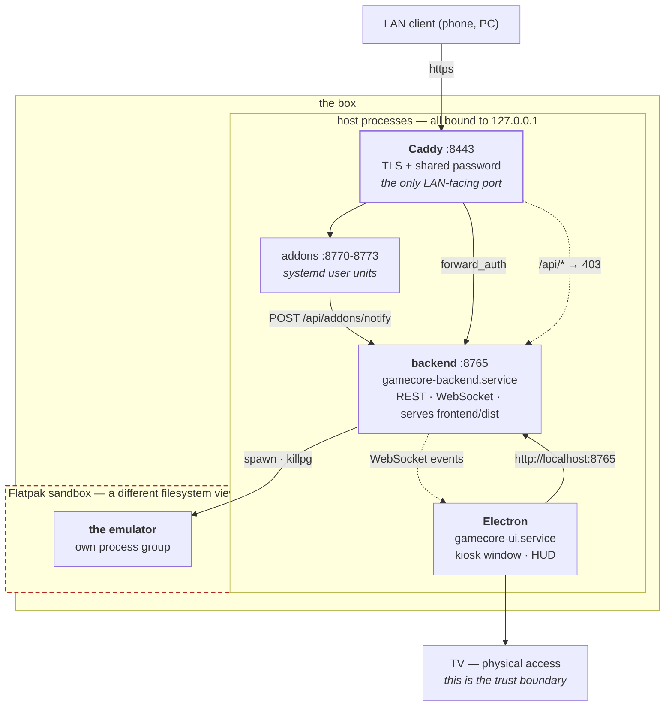
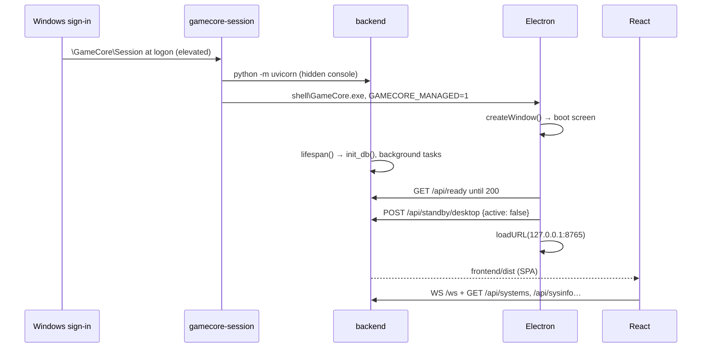
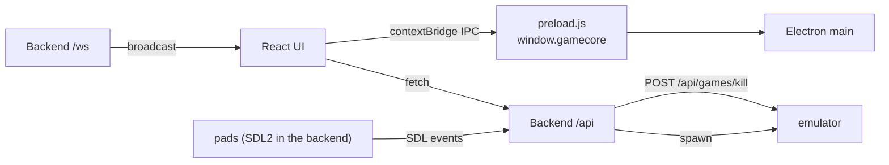

# 1 — Runtime topology

What runs, where it listens, who starts it, and in what order.

## The three processes

| Process | Started by | Listens | Owns |
|---|---|---|---|
| **Session** | the `\GameCore\Session` logon task, elevated, in the console user's session | — | `install/bin/gamecore-session`: starts the two below and restarts them |
| **Backend** | the session, with a console that is never shown | `127.0.0.1:8765` | the emulator process, playtime DB, covers, standby, pads (SDL2) |
| **Electron** | the session, with `GAMECORE_MANAGED=1` | — | the kiosk window, HUD toasts |
| **The emulator** | Backend, `platform/jobs.py` `spawn()` | — | its own Job Object (the whole process tree) |

Plus, out of band:

| Process | Unit | Listens |
|---|---|---|
| rom-manager | `\GameCore\Addons\rom-manager` task, at the console user's logon, elevated | `127.0.0.1:8770` |
| rpcs3-manager | `\GameCore\Addons\rpcs3-manager` | `127.0.0.1:8771` |
| save-manager | `\GameCore\Addons\save-manager` | `127.0.0.1:8772` |
| bios-manager | `\GameCore\Addons\bios-manager` | `127.0.0.1:8773` |
| Caddy | `GameCoreCaddy` Windows service | `:8443` — **the only LAN-facing port** |
| OpenSSH | `sshd` Windows service (optional feature) | `:22`, private networks only |

The addon tasks are registered by `gamecore-addon` (port step 9).
Ports 8770-8799 are reserved for addons. Vite (`:5173`) exists in development
only.

## The shape of it, including the sandbox boundary



**The dashed box is the part that catches people out.** The emulator does not
share the backend's filesystem view: it sees only what its Flatpak permissions
grant. That is why the installer adds `--filesystem` for the ROM directory and
`--device=all` for controllers per app, why a config written to
`~/.var/app/<id>/…` is the emulator's real config and one written elsewhere is
not, and why `flatpak kill <app-id>` has to come before any signal — a signal to
the wrapper never reaches inside.

**Everything except Caddy binds `127.0.0.1`.** The TV reaches the backend over
loopback with no authentication at all: physical access *is* the trust boundary.
The LAN only ever sees Caddy, and `/api/*` is 403 through it. If you add an
endpoint, assume the LAN can never call it — and see [9](09-gotchas.md) for why
"not LAN-exposed" still is not "not reachable" on a box that runs browsers.

## Boot sequence



`backend/main.py:lifespan()` is the single place background tasks are created
and cancelled:

```python
monitor_task  = asyncio.create_task(gamepad_monitor.run())
battery_task  = asyncio.create_task(battery.run())
standby_task  = asyncio.create_task(standby.run())
prefetch_task = asyncio.create_task(prefetch.run())
```

Electron's `startBackend()` is a **fallback for development only**: on an
installed PC the session owns the backend, and Electron never competes for the
port. "Managed" is `GAMECORE_MANAGED=1`, set by `gamecore-session` (dev log D24).

## When the interface appears

Nothing is timed. The shell waits on `GET /api/ready` — 200 once the backend's
required startup is done, 503 with the outstanding step until then — and the
interface then tells the shell it is worth looking at through `boot:ready`
(`electron/preload.js`), decided in the host by `frontend/src/lib/boot.ts`:
the theme resolved, the dashboard's own data settled, "Who's using this
controller?" decided (not asked, or drawn under the splash), and a frame painted.

The states are `STARTING → WAITING_BACKEND → LOADING_UI → PRESENTABLE →
RUNNING`, plus `RECOVERING`. Durations appear in exactly one role: bounding a
failure so it can be reported. Nothing is promoted by a clock.

A fixed 4 s hold used to be appended to the URL whenever the machine had booted
recently (`splashHoldMs()`), so the boot animation would not play against a
screen the TV had not finished re-syncing. The reason was real; the mechanism
was a duration measured on one box and paid by all of them. The splash now
holds its LAST frame until the host says the interface is ready — see
`docs/themes/README.md` §8.

## Who talks to whom



Three separate channels, deliberately:

1. **HTTP `/api`** — request/response, UI-initiated.
2. **WebSocket `/ws`** — backend-initiated push (game started/finished,
   battery, standby, addon notifications).
3. **IPC over `contextBridge`** — UI → Electron only, for things the browser
   cannot do (reboot, shut down, hide the window while a game plays).
   `preload.js` exposes a fixed set of methods and nothing else; `nodeIntegration` is off.

## The logon task, the services, the files they read

Written by `install/install.ps1` ([11](11-install-script-seams.md)):

| Piece | What | Why this form |
|---|---|---|
| `\GameCore\Session` | scheduled task: at the console user's sign-in, highest privileges, `.venv\Scripts\pythonw.exe install\bin\gamecore-session` | a window opens only in its own process's session; a service lives in session 0 (D8). Elevated: games inherit it, the wake settings need it (D36) |
| `gamecore-session` | starts the backend (`python -m uvicorn backend.main:app --host 127.0.0.1`), then the shell (`<code>\shell\GameCore.exe`) at once, since the shell waits for `/api/ready` itself; restarts either 5 s after a crash, 60 s after five in two minutes. A clean exit of the shell is Desktop mode and is not undone; the `GameCore` shortcut runs `gamecore-session` again, unelevated, and it only asks the running copy to start the shell (a named mutex and event whose descriptor lets the unelevated user see and set them) | the Linux units' `Restart=on-failure`, without a "failed" state nobody can reset on a console |
| `%ProgramData%\GameCore\session.env` | `GAMECORE_PATH`, `GAMECORE_DATA`, `GAMECORE_BACKEND_PORT`, the scraper keys; Administrators and SYSTEM only | the Linux unit's `Environment=` lines and its `override.conf` drop-in, in one file |
| `GameCoreCaddy` | Windows service, automatic, restarted on failure: `caddy\caddy.exe run --config install\system\Caddyfile`; `XDG_DATA_HOME` = `%ProgramData%\GameCore\caddy` (the local CA) | web access works before anyone signs in |
| `sshd` | the OpenSSH Server optional feature, automatic | as on the Linux box |
| `GameCore - Web access`, `GameCore - SSH` | inbound firewall rules, TCP 8443 and 22, Private profile only | the backend binds 127.0.0.1 and needs none |
| `%ProgramData%\GameCore\install-manifest.json` | what each step changed and the values it replaced | `install/uninstall.ps1` puts them back |
| `%ProgramData%\GameCore\update\` | the updater's work folder: `plan.json`, `update.lock`, `last-update.json` (the last update's outcome) | outside the code root, which an update renames ([13](13-release-and-ota.md)) |
| `<code>.prev`, `<code>.failed` | beside the code root: the version before the last update, and one an update or a rollback set aside | the way back is a rename, not a copy |

The backend's console is created with `CREATE_NO_WINDOW`: every console program
it runs (powercfg, wevtutil, tasklist, the SDL probes) inherits that hidden
console instead of flashing a window over the TV.

Logs: `<data>\logs\session\session.log` (the session itself),
`backend-console.log` and `interface-console.log` (what the two print), each
kept with one previous copy (`.1`). Updates log to `<data>\logs\update\update.log`.

Rest mode needs no root piece on Windows: the elevated backend holds the
shutdown privilege and sets which devices may wake the PC itself, see
[Rest mode](02-request-flows.md#5b-rest-mode-and-the-wake).

## The session the kiosk runs in

### On Windows: the backend runs in the console user's session

A window opens on the desktop of the session its process belongs to, and only
the active console session is on the TV. A Windows service lives in session 0,
which has no visible desktop, so the backend is **not** a service: it runs in
the console user's session, started at logon by a scheduled task with highest
privileges, restarted by `gamecore-session` ([above](#the-logon-task-the-services-the-files-they-read);
dev log D8). A game it starts inherits that desktop; nothing is rebuilt.

`session.launch_blocker()` (`backend/services/session.py`, over
`backend/services/platform/console_session.py`: `ProcessIdToSessionId`,
`WTSGetActiveConsoleSessionId`, `WTSQuerySessionInformationW`) refuses a
launch when that is not true: nobody logged on to the console, or the backend
in another session (started as a service, or the console taken over by Remote
Desktop). `session.desktop()` names the session, the user and the primary
display (`EnumDisplayDevicesW`) for logs. The display is not checked: a TV
that is off still lists its output.

### The console user's desktop

Explorer stays the console user's shell: GameCore's kiosk window covers it, and
Desktop mode leaves the kiosk for it (`electron/desktop.js`). Replacing the
shell for that user (Winlogon `Shell`) would boot without Explorer, but an
`explorer.exe` started later may then open a folder window instead of the
desktop Desktop mode needs; untested, so not done (dev log, open questions).

## Environment reconstruction

On Windows the backend already runs in the console user's session, so a game
gets the backend's own environment. `session.display_env()`
(`backend/services/session.py`) adds one variable:
`SDL_GAMECONTROLLERCONFIG_FILE`, the served controller database
(`configgen/mapping_db.py`).

## Development topology

```bash
uvicorn backend.main:app --port 8765            # backend (no --reload on Windows, see below)
cd frontend && npm run dev                      # Vite :5173
cd electron && ELECTRON_DEV=1 npx electron .    # shell → :5173
```

On Windows, `--reload` and `--workers` make uvicorn run the Selector event
loop, which cannot start subprocesses (`NotImplementedError` from
`asyncio.create_subprocess_exec`, used by the update router);
without them it runs the Proactor loop (`test_event_loop.py`). Games do not
depend on it: `platform/jobs.py` starts them with `subprocess.Popen`.

`DEBUG` exists twice — `backend/config.py` and `electron/main.js:16` — and
must be `false` on a device. `DEV` is `DEBUG && ELECTRON_DEV=1`; only then does
Electron load `:5173` instead of `:8765`.
