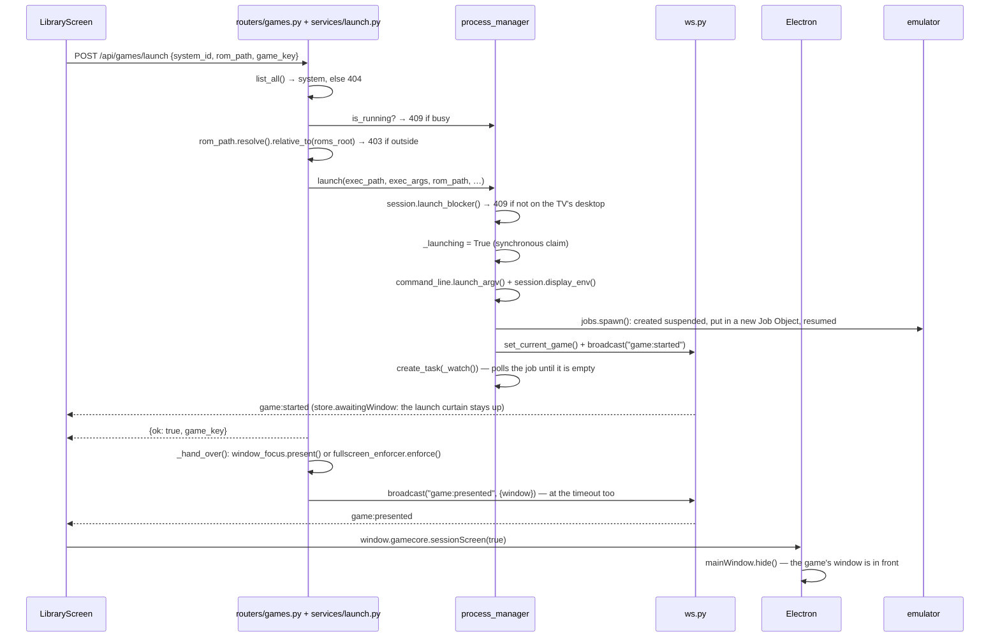
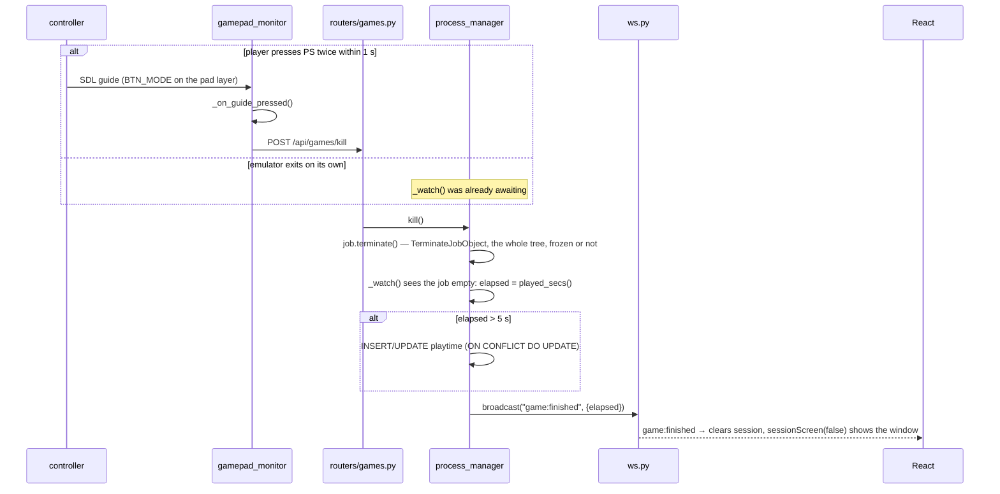
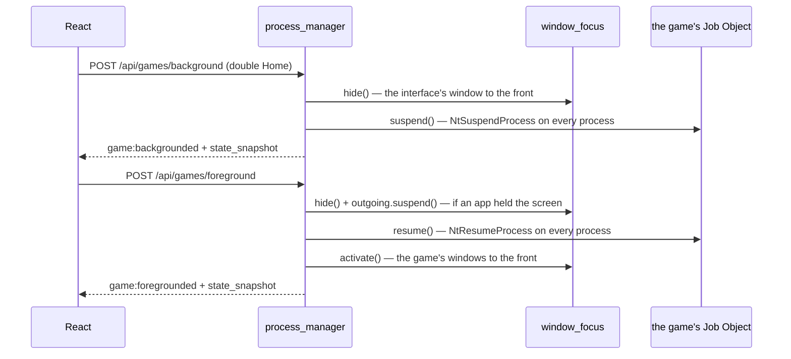
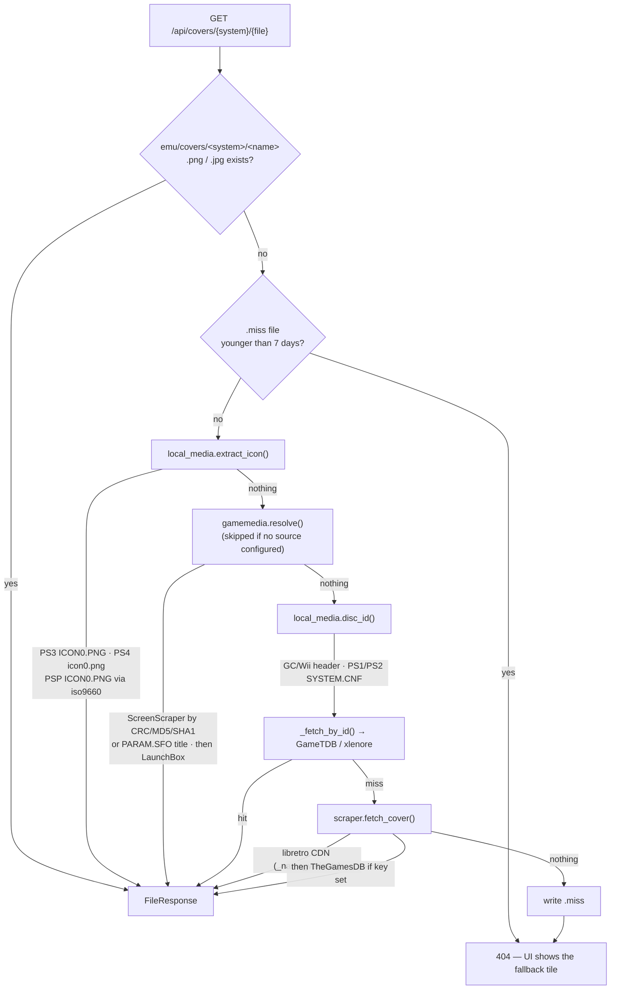
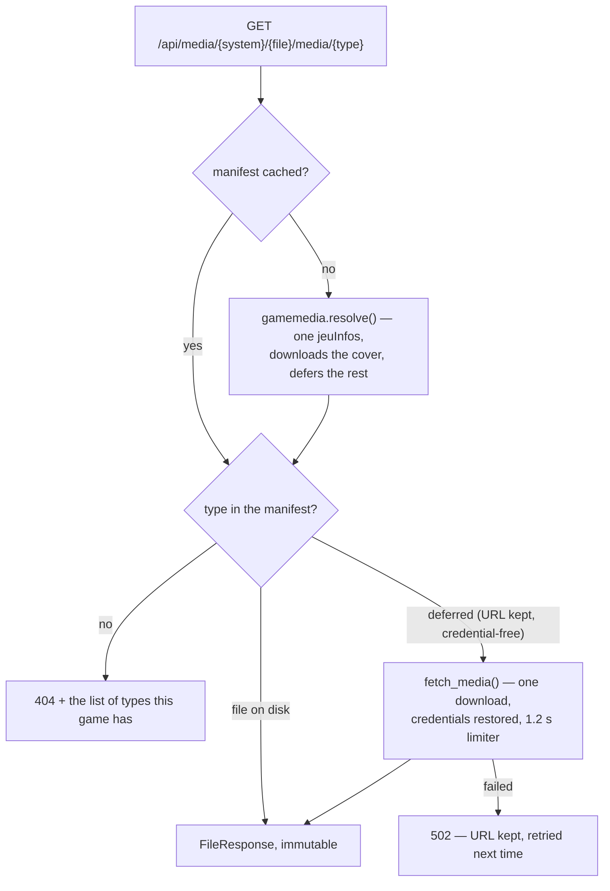
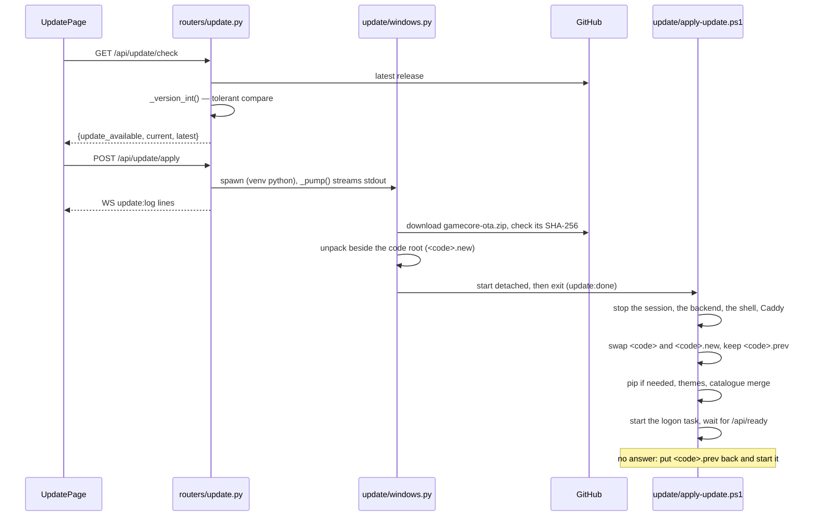
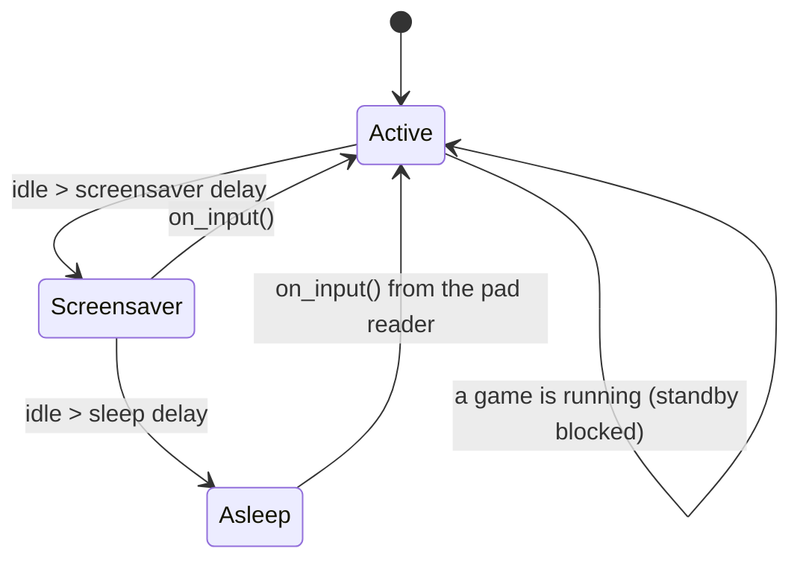
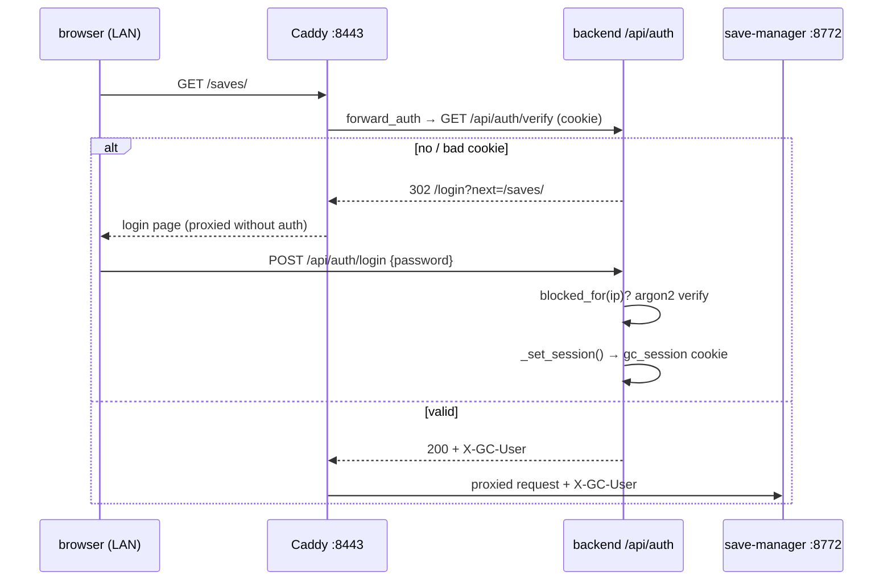

# 2 — Request flows

The paths worth knowing end to end. Every arrow names the function that runs.

## 1. Launching a game



An app tile (`defaults.launchApp()`) locks the pad and raises the launch
curtain at the press (`launchAppSession()`: an optimistic session plus
`awaitingWindow` = the app's name), before the POST answers, as on the Linux
box where the answer comes at once; a refusal gives the interface back.
Until `game:presented` the interface stays shown, black under
`LaunchCurtain`, and only then does the shell hide it: no empty desktop
while the app starts (`hooks/useSessionScreen.ts`, bounded by
`AWAIT_WINDOW_MAX_MS`, 50 s). The way out meanwhile is the same as in game:
the guide button. An app skips the pad-profile wait (emulator configs only;
it cost Steam 6.7 s on the port's PC).

After the spawn, `launch.py` schedules one fire-and-forget task for the new
game's window: `window_focus.present()` brings its first window to the front
(Windows keeps the foreground for the interface, which received the player's
last input), or, when the system entry carries `"fullscreen": {…}`,
`fullscreen_enforcer.enforce()` makes it borderless fullscreen first.
`"gamepadTrigger"` is no longer acted on: it re-fired udev for Flatpak, and
Windows has neither.

## 2. Ending a game

Two ways in, one way out.



Why it is built this way:

- **SDL in the backend, not the browser.** Chromium never exposes the Guide
  button and sees nothing while a fullscreen emulator has the focus; SDL with
  background events does.
- **Double press.** A single Guide press must never kill a game by accident
  (`GUIDE_DOUBLE_PRESS_MS`, mirrored in the frontend hook).
- **The job, never one process.** A launcher that starts the game and exits,
  or a game with helper processes, dies whole.
- **Terminate, never a polite close.** Several emulators answer a close
  request with a confirmation dialog nobody can click from a gamepad.
- **The 5 s floor.** An emulator that dies instantly is not a play session.

## 2b. Suspending and resuming a game



The interface goes in front **before** the freeze: a frozen window that has
the foreground never answers the activation messages, and Windows then
refuses to put it behind. Suspends and resumes are serialised (`_switching`);
each one awaits a window move before it freezes.

## 3. Resolving a cover



Entry point: `services/cover_pipeline.py:resolve(system, filename, refresh)`.
`?refresh=1` skips the cache and the `.miss` check.

Tiers 2 and 4 are **offline and exact** — they read the game itself, so they
never mis-identify. Tier 3 is exact too when the ROM is a real file: a
CRC32 the ScreenScraper database recognises identifies the game outright, which
is the only exact method available on a cartridge (no embedded icon, no serial
to read). Tier 5 is fuzzy name matching and is only reached when the game
carries no identity anywhere.

Tier 3 is also the one that can be **absent**: with no ScreenScraper account
and no LaunchBox index, `gamemedia.available()` is False and the flow is the
one that ran before it existed.

## 3b. Resolving any other media



The manifest is scraped once per game and holds every media the sources have.
Only what is displayed is downloaded: a first request for `box-3d` costs one
HTTP call and **no ScreenScraper quota**, because the URL was already recorded.

## 4. OTA update



Stage 2 runs detached and outside the code root on purpose: it stops the
backend that started it, and Windows refuses to rename a folder a running
program lives in. Details in [13](13-release-and-ota.md#what-the-updater-does).

## 5. Standby, and waking up



`services/standby.py:run()` polls. `_enter(stage)` drives the transitions,
`_screen(False)` turns the display off (`SC_MONITORPOWER`), `_governor("powersave")`
switches to the Power saver plan when the PC has one. `on_input()` is called from
`gamepad_monitor`'s read loop (SDL in the backend), which is why a controller
wakes the box even though the UI is asleep and the browser is not listening.

Every stage change reaches the UI as a crossfade: `frontend/src/lib/standbyFade.ts`
writes the stage inside `document.startViewTransition` (500 ms, set in
`frontend/index.html`; skipped under reduced motion), so every theme's standby
fades in and out without knowing it. Going to sleep, `_enter("sleep")`
broadcasts, then waits for the TV window's `POST /api/standby/dark` (sent when the
fade to black ends) before the screen goes off, so the TV loses signal on a black frame. It
waits at most `_UI_DARK_WAIT_SECS` (3 s), not at all with no WebSocket client,
and does not cut the screen if a press woke the box meanwhile.

## 5b. Rest mode, and the wake

```mermaid
sequenceDiagram
    participant ui as PowerModal
    participant be as rest_mode.enter()
    participant pm as process_manager
    participant win as Windows (platform/sleep.py)
    ui->>ui: store.setAsleep(true): black over everything
    ui->>be: POST /api/power/rest (second press)
    be->>be: launch.close_gate(), wait for a launch in flight (15 s)
    be->>pm: kill() every session, frozen ones too
    be->>be: poll each job; terminate survivors after 8 s; 2 s more
    be->>win: sleep.suspend() in a thread: S3 = SetSuspendState, Modern Standby = screen dark, PC held running
    win-->>be: SUSPEND (S3), or rest_mode itself (Modern Standby, dark_rest_began): power:sleeping, sleep_guard sweep
    Note over win: S3 asleep, the pad wakes it through the Bluetooth radio; Modern Standby running, the backend reads the pad
    win-->>be: RESUME (S3), or the first press (Modern Standby, dark_rest_ended) (resume.py)
    be->>be: sweep again, open the gate, screen on
    be->>be: wait for an active monitor (10 s max), display mode, settle delay
    be-->>ui: WS power:resumed (or GET /api/power/state after a reconnect)
    ui->>ui: store.wake(): black layer off, Home, splash from the start with its boot sound
```

- Nothing sleeps while a session is alive: every job is checked empty before
  `sleep.suspend()`. A job still alive after the forced terminate is logged
  and the box sleeps anyway.
- Two sleep models (`sleep.power_model()`, read once at start):
  - **S3**: `SetSuspendState` (the shutdown privilege enabled first) blocks
    until the wake, so it runs in a thread; Windows sends `SUSPEND` before
    sleeping and `RESUME` (`PBT_APMRESUMEAUTOMATIC`) after.
  - **Modern Standby** (S0 low-power idle; the port's PC is one): no call
    enters it, and `SetSuspendState` **hibernates** such a PC (measured on
    24/10/2026: S4, about 30 s to wake, and a pad cannot wake S4). Rest mode's
    sleep is therefore every game closed, the screen dark and the PC held
    running (dev-log D34, D56: switching the display off took this PC into
    standby, so it stays on, black, under a display-required power request). `resume.classify()` treats the console display
    going off **while Rest mode is under way** as the sleep and coming back on
    as the wake; a pad press lights it through standby (`standby.on_input()`
    after a silence). A display going off at any other time is standby's own
    screen-off and is ignored. If Windows' own sleep timer later takes the PC
    down, its suspend and resume events go through the S3 path (the port's
    PC sent them for a hibernation).
- **Every sleep closes the games**, not only Rest mode's (power button, Start
  menu, lid, idle timer): Windows' suspend event holds its power thread until
  the handler returns, about 2 s at most, and no lock buys more (logind's
  delay inhibitor did on Linux). `resume.run()` holds it up to
  `SUSPEND_HOLD_SECS` (1.8 s) while `sleep_guard.before_sleep()` closes the
  launch gate and runs Rest mode's sweep with short waits (0.8 s, then
  terminate, 0.3 s): ending a job is one `TerminateJobObject`. On the wake it
  sweeps again (a sleep that outran the sweep). The Rest mode button sweeps
  first, so the second sweep finds nothing. A sleep and a wake are each acted
  on once (`classify`), so a Modern Standby PC that also sends the callbacks
  is not swept or woken twice.
- The TV first: after a wake the HDMI link is back seconds before the
  picture. `power:sleeping` (and Rest mode's own second press) puts a plain
  black layer over everything; `resume.on_resume()` waits for an active
  monitor on an adapter attached to the desktop (`services/display_ready.py`,
  10 s at most, then it goes on anyway), then the player's `wake_settle_secs`
  (Settings → System, 0-8 s, 2.5 s default), and only then counts the wake and
  sends `power:resumed`. Windows can report the monitor active an instant
  before the TV shows the picture, which the settle delay covers.
- Electron's `powerMonitor` `resume` (`electron/power.js`) puts the main
  window back in fullscreen and focus, tells the renderer to cover itself in
  black and forces a full repaint; everything else is the backend's.
- Wake permission: `services/bt_wake.py` allows the Bluetooth radios, the
  Bluetooth pads on the roster (by address) and the wired pads (by
  vendor:product) to wake the PC (`platform/device_wake.py`, WMI
  `MSPower_DeviceWakeEnable`, elevated only), at start, after each wake and
  whenever a new pad joins the roster. Nothing is disarmed: on Windows a
  Bluetooth mouse wakes through the same radio as the pads (dev-log D36).
- What woke the box: `services/wake_source.py` keeps the newest
  `Power-Troubleshooter` record of the System log and, after the wake, logs
  the source of a newer one (`woken by …`). A Modern Standby wake logs none.
- Pads stay on into the sleep: Windows has no public call to drop one
  device's link (dev-log D28), so `bt_wake.turn_off_pads()` turns off nothing.
  On Linux an Xbox pad answered the kernel's "power off" disconnect by paging
  straight back, which woke the box; whether it does on Windows is untested.
- The power button's action and Windows' wake timers are the installer's
  (step 7).

## 6. LAN authentication



The core's own `/api/*` is **403 from the LAN, always**. Addons contain no
auth code — Caddy is the enforcement point. The TV bypasses all of this over
loopback.
