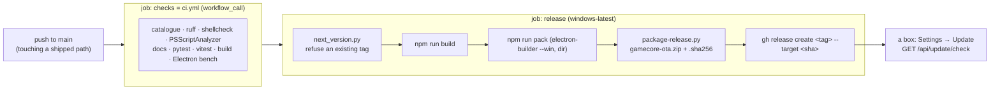

# 13 — Release and OTA

What a push to `main` sets in motion, what reaches a box, and how to go back.

`.github/workflows/release.yml`, `scripts/package-release.py`,
`update/windows.py` and `update/apply-update.ps1` are the authorities; this
page is a map of them.

> **A merge to `main` is a delivery, not a git operation.** There is no staging
> environment and no manual approval between the merge and a box offering the
> result in Settings → Update. Read [The gate](#the-gate-before-you-merge) before merging.

## What triggers a release

`release.yml` runs on a push to `main` **only when it touches something that
ships**:

```
backend/**  frontend/**  electron/**  update/**  install/**
config/**   assets/**    catalog/**   scripts/**  VERSION
.github/workflows/release.yml  .github/workflows/ci.yml
```

A documentation-only push cuts no release. Nothing else triggers it, on
purpose: the Linux original also ran on `workflow_dispatch` and on `v*` tags,
and a dispatch from a branch published a release named after the branch that
every box took for the latest. The release job also checks
`github.event_name == 'push' && github.ref == 'refs/heads/main'` itself.

**Two merges in a row queue.** `concurrency: release` (no cancel) runs one
release at a time: on Linux two merges 8 s apart computed the same tag and the
second run failed. A newer queued run replaces an older queued one; it is built
from a later `main`, so it carries those commits too.

## The pipeline



`checks` is `ci.yml` itself, called with `workflow_call`, so the release runs
exactly the pull-request checks before anything is tagged: a red suite never
becomes a release. The tag is created by `gh release create` on the commit that
was built; no third-party action holds `contents: write`.

### The version

`scripts/next_version.py` reads the last `v*` tag with `git describe` (hence
`fetch-depth: 0`) and bumps the patch, under a bounded scheme (major ≤ 99,
minor ≤ 9, patch ≤ 99; a field past its ceiling carries into the next, and the
ordering every comparator relies on survives the carry). With no tag at all it
prints `v0.1.0`, the first release of the Windows edition (dev log D1, D2: the
Linux tags were not carried). The tracked `VERSION` says `v0.0.0`: what a
checkout reports, older than every release.

## The asset

| Asset | What it is | Who takes it |
|---|---|---|
| `gamecore-ota.zip` | about 110 MB. The code root as `install/steps/copy-code-root.ps1` lays it out: every tracked file under `backend/ frontend/ electron/ config/ assets/ catalog/ scripts/ update/ install/`, the built `frontend/dist/`, the packed shell as `shell/`, and `VERSION` holding the tag | every installed box (update), and a fresh install (unpack, run `install\install.ps1`) |
| `gamecore-ota.zip.sha256` | `<hex>  gamecore-ota.zip` | the updater, which also compares GitHub's own `digest` of the asset when the API gives it |

One archive for both uses: on Windows the code root holds the assets too, so a
separate "full" archive would be the same bytes (dev log D49). Never in it:
what the installer puts in the code root (`python\`, `.venv\`, `caddy\`), the
player's data, `node_modules`, caches.

Two rules kept from the Linux packaging, each learned from a real bug:

- **`frontend/` whole, sources included**, not just `dist/`: a box left with
  sources older than the build it runs rolls its UI back the moment anything
  rebuilds there.
- **`VERSION` carries the tag**, not the tracked file: shipping `v0.0.0` would
  make every install report itself out of date.

The shell is unsigned (no certificate yet, an open question): the release
build turns certificate discovery off. Locally, `npm run pack` needs
`-c.win.signAndEditExecutable=false` unless the account may create symbolic
links (electron-builder's signing tools unpack macOS symlinks); the runner can.

## What the updater does

Two stages, because the code root cannot be replaced by a process running from
it: Windows refuses to rename a folder while a program inside it runs, and the
session, the backend, the shell and Caddy all run from `<code>`.

```mermaid
sequenceDiagram
    participant ui as UpdatePage
    participant r as routers/update.py
    participant s1 as update/windows.py (stage 1)
    participant gh as GitHub
    participant s2 as apply-update.ps1 (stage 2)
    participant t as \GameCore\Session task

    ui->>r: GET /api/update/check
    r->>gh: latest release, _version_int() compare
    ui->>r: POST /api/update/apply (409 if one runs)
    r->>s1: venv python update\windows.py install
    s1->>gh: release JSON, gamecore-ota.zip, .sha256
    s1->>s1: SHA-256, free space, unpack to <code>.new, check VERSION = tag
    s1->>s2: start detached (breakaway from the job if allowed)
    s1-->>ui: last line, update:done
    s2->>s2: stop session processes (pythonw first) + GameCoreCaddy
    s2->>s2: <code> → <code>.prev, <code>.new → <code>, carry python\ .venv\ caddy\
    s2->>s2: pip if requirements changed; windows.py finish (themes, catalogue)
    s2->>t: Start-ScheduledTask (Caddy started again)
    s2->>s2: wait for /api/ready to answer (any status), 180 s
    Note over s2: no answer or any failure after the swap:<br/>stop, <code> → <code>.failed, <code>.prev → <code>, start
```

### Stage 1 — `update/windows.py install`

Run by the backend with its own interpreter (the installation's venv), its
output streamed line by line as `update:log`. Stdlib only, importing nothing
from the code it replaces. It changes nothing in the code root:

1. Refuses a source checkout (`.git` in the code root: update it with git).
2. Takes `<state>\update\update.lock` (`%ProgramData%\GameCore\update`); a lock
   whose process is gone is taken over.
3. Reads the latest release; stops if it is not newer than `VERSION`
   (`--force` reinstalls).
4. Downloads the zip, checks it against the published SHA-256 (the `.sha256`
   asset and GitHub's `digest` must agree; a release with neither is refused).
5. Checks free space next to the code root (twice the unpacked size), unpacks
   to `<code>.new` refusing any entry outside it, and checks the release is
   complete and its `VERSION` is the tag.
6. Writes `plan.json` (every path stage 2 touches), copies the release's
   `apply-update.ps1` to the work directory and starts it detached, with
   `CREATE_BREAKAWAY_FROM_JOB` when the logon task's job allows it. The lock
   now names stage 2.

Typed at an elevated prompt, it reads the roots from `session.env` when the
environment has none (`--env-file`); guessing a data root would merge the
catalogue into a folder nobody reads.

### Stage 2 — `update/apply-update.ps1 -Plan`

Elevated (inherited from the backend), from the work directory, logging to
`<data>\logs\update\update.log` and writing the outcome to
`<state>\update\last-update.json` (`installed`, `failed` before the swap,
`rolled-back`, or `broken` if the way back failed too):

1. Waits 3 s, so `update:done` reaches the interface.
2. Stops every process whose executable is in the code root, the supervisor
   (`pythonw`) first so it does not restart the backend, with `Stop-Process
   -Force` (TerminateProcess, like `taskkill /F`: a `WM_CLOSE` makes the kiosk
   rebuild its window). Then `GameCoreCaddy` if it runs.
3. Swaps by rename (same volume, so atomic): `<code>` → `<code>.prev` (the
   older `.prev` removed first), `<code>.new` → `<code>`, then moves
   `python\`, `.venv\` and `caddy\` from `.prev` into the new root. The venv's
   absolute paths stay right because the final path is the same.
4. Runs pip only when `backend\requirements.txt` differs from the stamp
   `install-python.ps1` writes.
5. Runs `update\windows.py finish` with the new venv (`update/finish.py`):
   themes into the data root, then the catalogue merge. Neither is fatal.
6. Starts Caddy again, then the `\GameCore\Session` task (or
   `gamecore-session` directly where there is no task), and waits up to 180 s
   for `/api/ready` to answer at all: a 503 ("still starting") counts, a
   refused connection does not.

Any failure after the swap rolls back by itself; a failure before it starts
the old code again and changes nothing. Caddy's configuration now updates with
the code: the service reads `install\system\Caddyfile` from the code root.

### Themes — `update/finish.py`

| On the box | In the release | Result |
|---|---|---|
| present | absent | never touched (a theme you wrote is yours) |
| absent | present | installed |
| older version | newer version | replaced by rename, previous kept in `config\themes\.prev\<id>` |
| same, newer, or unreadable version | — | left alone |

The player's selection (`config\theme.json`) is never touched.

### What an update does not touch

The data root (ROMs, saves, `config\`, covers, logs) except the theme delivery
and the merge above; `%ProgramData%\GameCore` except the work directory; the
installer's other pieces (firewall, OpenSSH, power settings, the task itself).
A change to those needs `install\install.ps1` again: an update cannot rewrite
the installer's machine settings, by design.

## Going back — `<code>.prev`

One snapshot: the version that ran before the last update, kept whole as
`<code>.prev` (a rename, so it costs no space). By hand, from an elevated
PowerShell:

```powershell
& 'C:\Program Files\GameCore\update\apply-update.ps1' -Rollback
```

It copies itself out of the code root first (that folder is renamed), stops
GameCore, moves `python\ .venv\ caddy\` back, renames the current root to
`<code>.failed` and `.prev` into place, and starts the task again. `-CodeRoot`
and `-EnvFile` name another install. It gets you back one release, not to an
arbitrary one; the next update overwrites `.prev`. A rolled-back version is
older than the latest release, so Settings → Update offers it again.

## The gate before you merge

Because there is nothing between a merge and a living-room box:

- the CI checks green (see [`../TESTING.md`](../TESTING.md));
- the test count has not **dropped**;
- no **new** `skip` or `xfail`;
- `git diff main..HEAD -- 'catalog/*/tests/fixtures/*'` empty, unless you added
  the scenarios yourself and can name them;
- merge one pull request, wait for its "Build and Release" run, then the next.

One point failing means do not merge. An unmerged branch merges tomorrow; a
broken release has already left.

And if the temptation is to pass the gate by deleting a test, adding a `skip` or
regenerating a fixture, that is the moment to stop. **The gate is the
thermometer, not the objective.**

Record the SHA of `main` before merging. It is the way back, and without it there
is not one.
